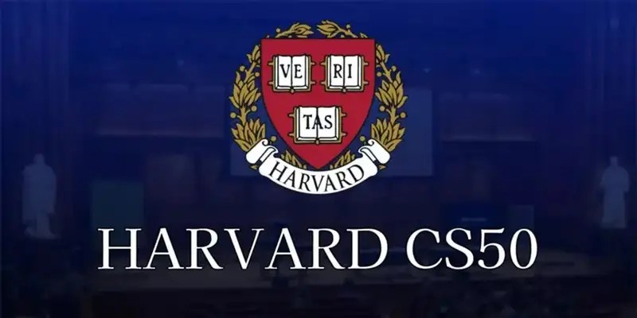
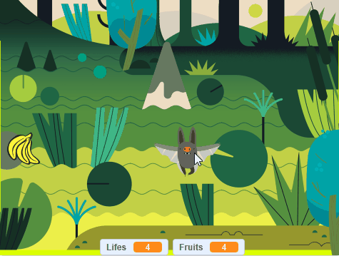

# Batlife - CS50 Problem Set 0

[Português (PT-BR)](README_pt.md)

Welcome to **Batlife**, a game developed in Scratch for Harvard's CS50 (Introduction to Computer Science) Problem Set 0!

    
     

## 🎨 Project Visual

    
     

## About the Game
Batfilfe is an interactive 2D arcade-style game built using block-based programming in Scratch. The player controls a character navigating through obstacles or challenges, aiming to score points while avoiding failure conditions.

## Features
- Custom-designed sprites and backdrops.
- Smooth keyboard controls for player movement.
- Score tracking system.
- Increasing difficulty or dynamic gameplay loops.

## How to Play
1. Open the project link on the [Scratch Website - Batlife](https://scratch.mit.edu/projects/1382953657/) (or download the `Batfilfe.sb3` file).
2. Load the project into the Scratch offline editor or web player.
3. Click the green flag to start the game.
4. Use the controls (such as arrow keys or spacebar) to play and achieve the highest score possible!

## Requirements
- A modern web browser or the [Scratch Desktop App](https://scratch.mit.edu/download).

---
*Created as part of Harvard University's CS50 course.*
