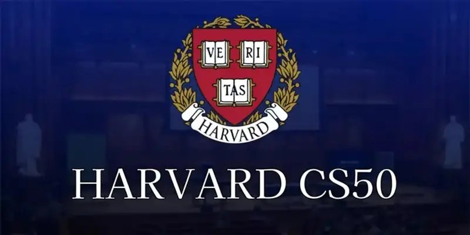
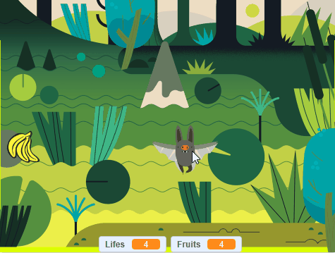

# Batfilfe - CS50 Problem Set 0

[English (EN)](README_en.md)

Bem-vindo ao **Batfilfe**, um jogo desenvolvido em Scratch para o Problem Set 0 do curso CS50 (Introdução à Ciência da Computação) de Harvard!

    
     

## 🎨 Project Visual

    
     

## Sobre o Jogo

O Batfilfe é um jogo arcade 2D interativo construído utilizando programação em blocos no Scratch. O jogador controla um personagem que navega por obstáculos ou desafios, com o objetivo de pontuar enquanto evita condições de derrota.

## Funcionalidades

- Sprites e cenários personalizados.
- Controles de teclado fluidos para a movimentação do jogador.
- Sistema de pontuação.
- Loops de jogabilidade dinâmicos.

## Como Jogar

- Abra o link do projeto no [Site do Scratch - Batlife](https://scratch.mit.edu/projects/1382953657/) (ou faça o download do arquivo `Batfilfe.sb3`).
- Carregue o projeto no editor offline do Scratch ou no player web.
- Clique na bandeira verde para iniciar o jogo.
- Utilize os controles (como as setas do teclado ou a barra de espaço) para jogar e alcançar a maior pontuação possível!

## Requisitos

- Um navegador web moderno ou o [Aplicativo Desktop do Scratch](https://scratch.mit.edu/download).

---

_Criado como parte do curso CS50 da Universidade de Harvard._
